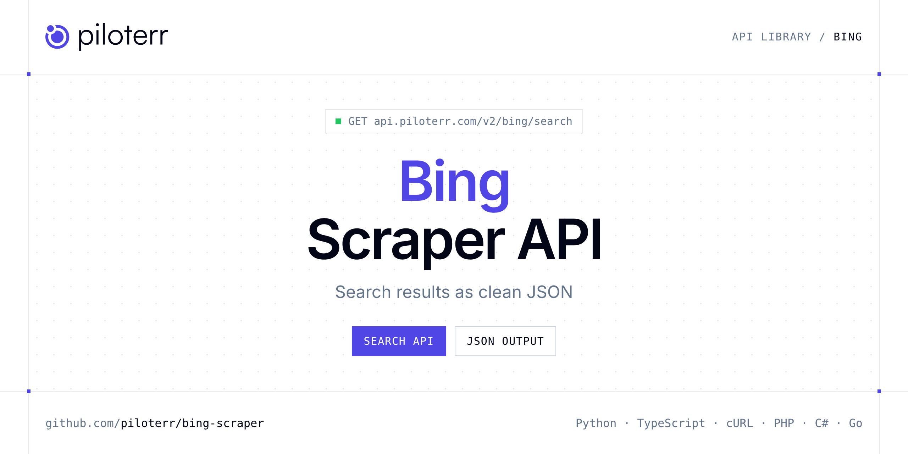

<p align="center">
  <a href="https://www.piloterr.com"></a>
</p>

# Bing Scraper API

[](https://discord.gg/CFj3ph8aHU) [](https://app.piloterr.com) [](https://app.piloterr.com/openapi) [](LICENSE)

The **Piloterr Bing Scraper API** lets you extract public data from Bing as **clean, structured JSON** — no proxies, headless browsers or HTML parsing to maintain. Endpoints available in production:

- **Bing Search API** — Scrape real-time Bing search results with full control over location, language, and pagination.

Use it for SEO rank tracking, SERP monitoring, ad intelligence, market research or grounding LLM answers with fresh search results.

| Endpoint | Path | Credits | What you get |
|---|---|---|---|
| [Bing Search API](#bing-search-api) | `/v2/bing/search` | 1 | Scrape real-time Bing search results with full control over location, language, and pagination. |

## Table of contents

- [How it works](#how-it-works)
- [Bing Search API](#bing-search-api)
- [Code examples in other languages](#code-examples-in-other-languages)
- [Practical use cases](#practical-use-cases)
- [Why Piloterr?](#why-piloterr)
- [FAQ](#faq)
- [Related scrapers](#related-scrapers)
- [Support](#support)

## How it works

1. **Create a free Piloterr account** and copy your API key from the [dashboard](https://app.piloterr.com).
2. **Send a `GET` (or `POST`) request** to `https://api.piloterr.com/v2/...` with the header `x-api-key: YOUR_API_KEY`.
3. **Receive structured JSON** — Piloterr handles rendering, proxies, retries and parsing.

```bash
export PILOTERR_API_KEY="your-api-key"
pip install requests        # Python
# TypeScript: Node.js 18+ (native fetch), run with `npx tsx file.ts`
```

> Every endpoint accepts both `GET` (query string) and `POST` (JSON body with the same fields).

## Bing Search API

Scrape real-time Bing search results with full control over location, language, and pagination.

`GET | POST https://api.piloterr.com/v2/bing/search` · **1 credit per request** · [Full reference](https://app.piloterr.com/openapi)

### Request parameters

| Parameter | Type | Required | Description |
|---|---|---|---|
| `query` | string | ✅ | The search query to execute on Bing. Supports all Bing advanced search operators. |
| `page` | number | — | Page number of results to retrieve. Used for pagination. |
| `num` | number | — | Number of results per page. **Minimum:** `10`, **Maximum:** `50`. |
| `location` | string | — | City or region from which the search should originate. If multiple locations match, the most popular one is selected. |
| `lat` | number | — | GPS latitude coordinate for the search origin. |
| `lon` | number | — | GPS longitude coordinate for the search origin. |
| `mkt` | string | — | Market code combining language and country, in the form `<language>-<country>`. Defines where the results come from. |
| `cc` | string | — | Two-letter ISO 3166-1 country code defining the country to search from. |

### Python example

```python
import json
import os
import requests

response = requests.get(
    "https://api.piloterr.com/v2/bing/search",
    headers={"x-api-key": os.environ["PILOTERR_API_KEY"]},
    params={
        "query": "artificial intelligence news 2024",
    },
    timeout=60,
)
response.raise_for_status()
data = response.json()

print(json.dumps(data, indent=2, ensure_ascii=False)[:2000])
```

### TypeScript example

```typescript
type BingSearch = {
  pagination?: {
    next?: unknown;
    current?: number;
    other_pages?: unknown[];
    has_next_page?: boolean;
  };
  organic_results?: {
    link?: string;
    title?: string;
    domain?: string;
    snippet?: unknown;
    position?: number;
    displayed_link?: string;
    snippet_matched?: unknown[];
  }[];
  search_parameters?: {
    q?: string;
    cc?: unknown;
    lat?: unknown;
    lon?: unknown;
    mkt?: unknown;
    num?: unknown;
    page?: number;
    engine?: string;
    location?: unknown;
    bing_domain?: string;
  };
  search_information?: {
    total_results?: unknown;
  };
};

const params = new URLSearchParams({
  "query": "artificial intelligence news 2024",
});

const response = await fetch(`https://api.piloterr.com/v2/bing/search?${params}`, {
  headers: { "x-api-key": process.env.PILOTERR_API_KEY! },
});
if (!response.ok) throw new Error(`Piloterr error ${response.status}: ${await response.text()}`);

const data = (await response.json()) as BingSearch;

console.log(JSON.stringify(data, null, 2).slice(0, 2000));
```

<details>
<summary><b>POST variant</b></summary>

```http
POST https://api.piloterr.com/v2/bing/search
x-api-key: YOUR_API_KEY
Content-Type: application/json

{"query": "artificial intelligence news 2024"}
```
</details>

### Output example

Example response from the API reference, abridged — real values depend on the page you scrape.

```json
{
  "pagination": {
    "next": null,
    "current": 1,
    "other_pages": [],
    "has_next_page": false
  },
  "organic_results": [
    {
      "link": "https://en.m.wikipedia.org/wiki/Artificial_intelligence",
      "title": "Artificial intelligence - Wikipedia",
      "domain": "en.m.wikipedia.org",
      "snippet": null,
      "position": 1,
      "displayed_link": "https://en.m.wikipedia.org › wiki ›Artificial_intelligence",
      "snippet_matched": []
    },
    {
      "link": "https://www.britannica.com/technology/artificial-intelligence",
      "title": "Artificial intelligence (AI) | Definition, Examples, Types ...",
      "domain": "britannica.com",
      "snippet": null,
      "position": 2,
      "displayed_link": "https://www.britannica.com › technology ›artificial-intelligence",
      "snippet_matched": []
    }
  ],
  "search_parameters": {
    "q": "artificial intelligence",
    "cc": null,
    "lat": null,
    "lon": null,
    "mkt": null,
    "num": null,
    "page": 1,
    "engine": "bing",
    "location": null,
    "bing_domain": "bing.com"
  },
  "search_information": {
    "total_results": null
  }
}
```

### Response fields

| Field | Type | Description |
|---|---|---|
| `pagination` | object |  |
| `pagination.next` | object |  |
| `pagination.current` | integer |  |
| `pagination.other_pages` | any[] |  |
| `pagination.has_next_page` | boolean |  |
| `organic_results[]` | object[] |  |
| `organic_results[].link` | string |  |
| `organic_results[].title` | string |  |
| `organic_results[].domain` | string |  |
| `organic_results[].snippet` | object |  |
| `organic_results[].position` | integer |  |
| `organic_results[].displayed_link` | string |  |
| `organic_results[].snippet_matched` | any[] |  |
| `search_parameters` | object |  |
| `search_parameters.q` | string |  |
| `search_parameters.cc` | object |  |
| `search_parameters.lat` | object |  |
| `search_parameters.lon` | object |  |
| `search_parameters.mkt` | object |  |
| `search_parameters.num` | object |  |
| `search_parameters.page` | integer |  |
| `search_parameters.engine` | string |  |
| `search_parameters.location` | object |  |
| `search_parameters.bing_domain` | string |  |
| `search_information` | object |  |

## Code examples in other languages

Ready-to-run examples live in the [`examples/`](examples) folder. Each one reads your key from the `PILOTERR_API_KEY` environment variable.

| Language | Search |
|---|---|
| cURL (Bash) | [`search`](examples/curl/search.sh) |
| PHP | [`search`](examples/php/search.php) |
| C# | [`search`](examples/csharp/Search.cs) |
| Go | [`search`](examples/go/search.go) |
| Java | [`search`](examples/java/SearchExample.java) |
| Ruby | [`search`](examples/ruby/search.rb) |
| Node.js | [`search`](examples/nodejs/search.mjs) |

## Practical use cases

- **SEO rank tracking** — Track positions of your pages and competitors on target keywords.
- **SERP monitoring** — Watch features, snippets and new entrants on strategic queries.
- **LLM grounding** — Feed AI agents and RAG pipelines with fresh search results.
- **Ad intelligence** — See who advertises on your keywords and with which messages.
- **Market research** — Map competitors, news and trends at scale.

## Why Piloterr?

- **No infrastructure** — no proxies, headless browsers or CAPTCHA solving to run yourself.
- **Structured JSON** — stable, documented fields instead of brittle HTML selectors.
- **Pay per request** — transparent credit cost per endpoint, failed requests are retried for you.
- **One API key, hundreds of sources** — Bing plus many other e-commerce, search and company data endpoints in the [Piloterr library](https://www.piloterr.com/library).
- **Any language** — plain HTTPS + JSON, with examples for Python, TypeScript, cURL, PHP, C#, Go, Java, Ruby and Node.js.

## FAQ

### Is it legal to scrape Bing?

Collecting publicly available data is generally allowed in many jurisdictions, but rules depend on your country, the data you collect and how you use it. Avoid personal data unless you have a lawful basis, respect the website's terms where they apply, and get legal advice for your specific use case. This is not legal advice.

### Do I need proxies or a headless browser?

No. Piloterr handles rendering, proxy rotation and retries on its side. You only send an HTTPS request with your `x-api-key` header and receive JSON.

### How much does a request cost?

Credits per call: `/v2/bing/search` **1**. See the [Piloterr website](https://www.piloterr.com) for plans.

### What data does the Bing API return?

Each endpoint returns structured JSON: **Bing Search** — `pagination`, `pagination.next`, `pagination.current`, `pagination.other_pages`, `pagination.has_next_page`, `organic_results[]`.

### How do I paginate Bing results?

Use the `page` parameter and keep requesting while the response indicates more results.

### Which languages are supported?

Any language that can make an HTTP request. This README shows Python and TypeScript; the [`examples/`](examples) folder contains cURL, PHP, C#, Go, Java, Ruby and Node.js.

## Related scrapers

- [Brave Scraper API](https://github.com/piloterr/brave-scraper)
- [Google Scraper API](https://github.com/piloterr/google-scraper)
- [Google Ads Transparency Scraper API](https://github.com/piloterr/googleadstransparency-scraper)
- [All Piloterr scrapers on GitHub](https://github.com/piloterr)

## Support

- 💬 Join the [Piloterr Discord](https://discord.gg/CFj3ph8aHU) to ask questions and share what you build.
- 📚 Browse the [API reference (OpenAPI)](https://app.piloterr.com/openapi) and the [Piloterr library](https://www.piloterr.com/library).
- 🔑 [Get your API key](https://app.piloterr.com).

---

<p align="center">
  <a href="https://www.piloterr.com">
    <picture>
      <source media="(prefers-color-scheme: dark)" srcset="images/logo-dark.svg">
      
    </picture>
  </a>
  <br>
  <sub>Built by <a href="https://www.piloterr.com">Piloterr</a> — web scraping APIs for e-commerce, search, real estate and more, one API key.</sub>
</p>

<sub>Bing is a trademark of its respective owner. This repository is not affiliated with or endorsed by Bing. Examples are released under the MIT license.</sub>
